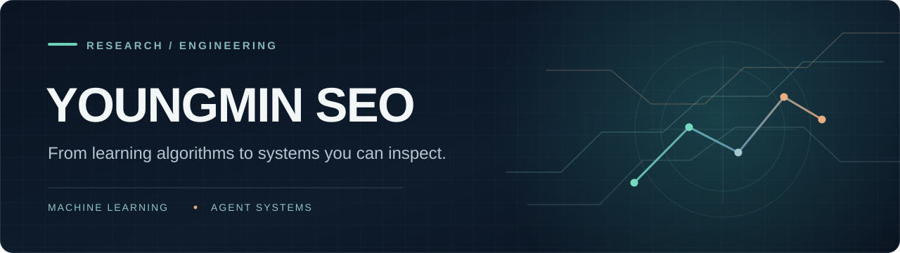
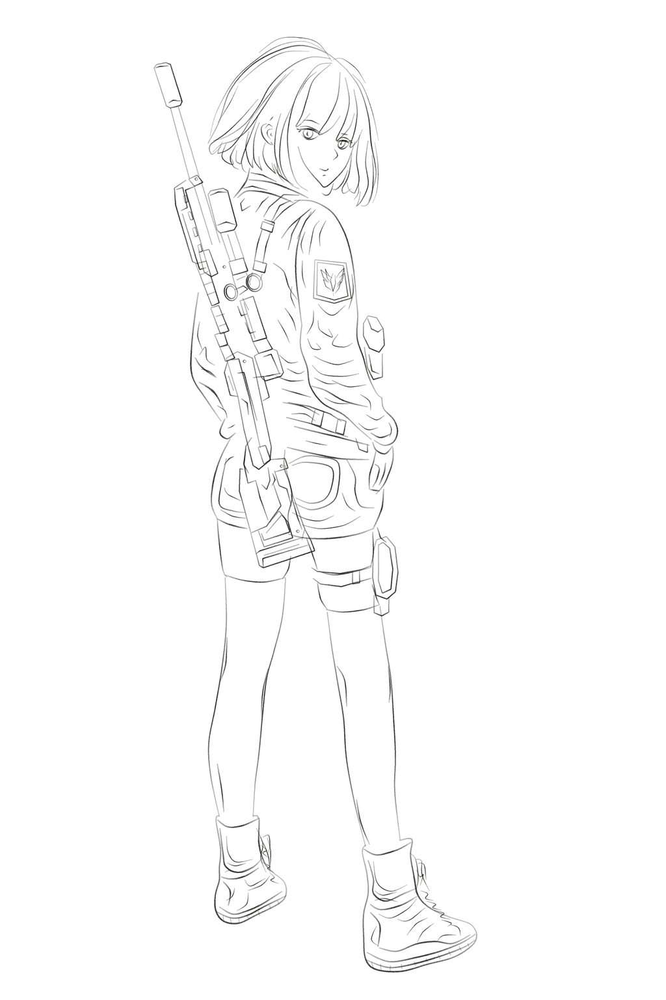
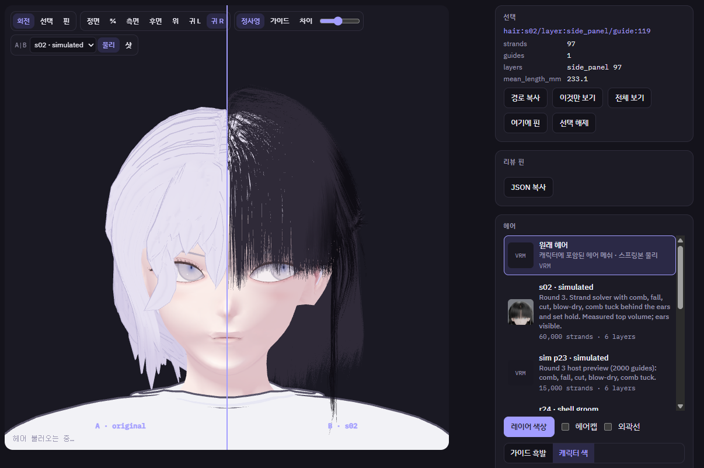
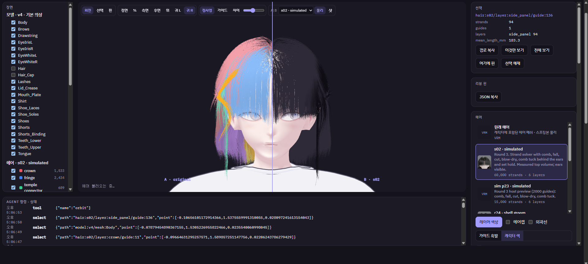
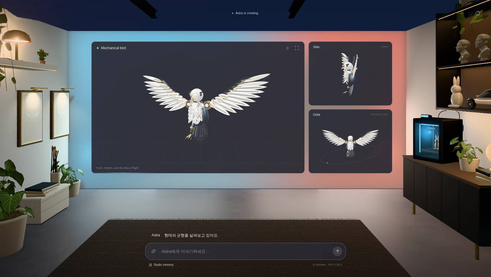

  
  
<strong>Machine Learning Research &nbsp;·&nbsp; Agent Systems &nbsp;·&nbsp; Computer Graphics</strong>

  

    <a href="#research--publications">Research</a> &nbsp;·&nbsp;
    <a href="#agent-skills--selected-work">Agent Skills</a> &nbsp;·&nbsp;
    <a href="#systems--tooling">Systems</a> &nbsp;·&nbsp;
    <a href="#ongoing-explorations">Explorations</a>
  

## About

I study machine learning models and build software systems around them. My work began with computer vision and neural-network architectures and has expanded into **agent workflows, 3D reconstruction, and tools for inspecting real outputs**.

One question connects these interests: **how can I verify that a system produced what it was intended to produce?** I try to make that question part of the workflow, from research experiments to software prototypes.

## Research & publications

<table>
  <tr>
    <td width="14%" valign="top"><strong>2026</strong> ACM TODAES</td>
    <td valign="top">
      <strong><a href="https://doi.org/10.1145/3847672">WACA-UNet — Weakness-Aware Channel Attention for Static IR-drop Prediction</a></strong> 
      A computer-vision-based approach to estimating voltage-drop regions from heterogeneous chip-layout maps, with attention to underrepresented input features. 
      <a href="https://github.com/ictseoyoungmin/WACA-UNet">Source code</a> · <a href="https://arxiv.org/abs/2507.19197">Preprint</a>
    </td>
  </tr>
  <tr>
    <td valign="top"><strong>2026</strong> IEEE Access</td>
    <td valign="top">
      <strong><a href="https://doi.org/10.1109/ACCESS.2026.3667968">Swish-T — Enhancing Swish Activation with Tanh-Based Bias</a></strong> 
      An activation-function family exploring how bounded tanh-based bias changes learning behavior across network architectures. 
      <a href="https://github.com/ictseoyoungmin/Swish-T-pytorch">PyTorch implementation</a> · <a href="https://arxiv.org/abs/2407.01012">Preprint</a>
    </td>
  </tr>
  <tr>
    <td valign="top"><strong>2023</strong> Applied Sciences</td>
    <td valign="top">
      <strong><a href="https://doi.org/10.3390/app13052922">DRRU-Net — DCT-Coefficient-Learning RRU-Net for Image-Splicing Forgery Detection</a></strong> 
      An image-forensics model that combines learned visual features with JPEG compression artifacts in the DCT domain. 
      <a href="https://github.com/ictseoyoungmin/DRRU-Net">Source code</a> · <a href="https://doi.org/10.3390/app13052922">Paper</a>
    </td>
  </tr>
</table>

  
<strong>View a research figure — Swish-T activation study</strong>

  

    
  

## Agent Skills & selected work

I build tools that let agents construct, inspect, and revise actual artifacts — whether that's a line drawing, a 3D asset, or an interactive environment.

### img2drawing · Explicit stroke authoring

<table>
  <tr>
    <td width="118" align="center" valign="middle">
      
    </td>
    <td valign="middle">
      <strong><a href="https://github.com/ictseoyoungmin/img2drawing">img2drawing ↗</a></strong> 
      An agent drawing workflow based on <strong>explicit pencil strokes</strong> rather than one-shot image generation. Observation, authored strokes, rendering, and revision remain inspectable and replayable. 
      Python · Stroke geometry · Rendering · Revision · Timelapse 
      <a href="https://github.com/ictseoyoungmin/img2drawing/tree/main/showcase">Showcase and source examples</a>
    </td>
  </tr>
</table>

   
  <strong>Character drawing process</strong> · Pencil-stroke timelapse

  
<strong>Finished character drawing</strong>

  

     
    Finished line drawing
  

   
  Additional pencil line studies

### RefAs · Reference Asset Foundry

<table>
  <tr>
    <td width="118" align="center" valign="middle">
      
    </td>
    <td valign="middle">
      <strong><a href="https://github.com/ictseoyoungmin/refas">RefAs ↗</a></strong> 
      Vision-first 3D reconstruction tooling for observing references, building editable geometry, reviewing GLB renders, and revising individual parts through recorded evidence. 
      3D reconstruction · GLB · Multiview comparison · Evidence 
      <a href="https://github.com/ictseoyoungmin/refas/tree/main/examples/parameter-fit">Parameter-fit fixture</a> · <a href="https://github.com/ictseoyoungmin/refas/tree/main/examples/hard-surface">Hard-surface example</a>
    </td>
  </tr>
</table>

### Immersive Web Simulation Forge

<table>
  <tr>
    <td width="118" align="center" valign="middle">
      
    </td>
    <td valign="middle">
      <strong><a href="https://github.com/ictseoyoungmin/immersive-web-simulation-forge">Immersive Web Simulation Forge ↗</a></strong> 
      Reusable tools and examples for spatial web experiences and technical simulations, with functional state, deterministic capture, and explicit inspection. 
      Three.js · WebGL · Simulation · Browser QA
    </td>
  </tr>
</table>

<table>
  <tr>
    <td width="50%" align="center" valign="top">
       
      <strong>AEROLAB X4</strong> · Wind-tunnel example
    </td>
    <td width="50%" align="center" valign="top">
       
      <strong>Ocean</strong> · Real-time graphics example
    </td>
  </tr>
</table>

## Systems & tooling

<table>
  <tr>
    <td width="50%" valign="top">
       
      <strong><a href="https://github.com/ictseoyoungmin/HADARA">HADARA · Agent development evidence ↗</a></strong>
      
A local-first development workflow built around task capsules, inspectable evidence, current-state recovery, and guarded handoffs.

      Node.js · CLI · Agent infrastructure
    </td>
    <td width="50%" valign="top">
      <h3><a href="https://github.com/ictseoyoungmin/talarion">Talarion ↗</a></h3>
      <strong>One game. Many runtimes.</strong>
      
An evolving portability and QA toolchain for games built for the web and Android, with replay, state comparisons, and target-specific checks.

      JavaScript · Three.js · Godot · Android QA
      
    </td>
  </tr>
</table>

## Ongoing Explorations

Additional experiments in procedural 3D authoring and spatial interfaces.

### Procedural character & hair authoring

Strand-based hair geometry, layered guides, and interactive side-by-side comparisons for developing and inspecting character appearance.

   
  <strong>Hair appearance comparison</strong>

   
  <strong>Hair guide-layer inspection</strong>

### Interactive 3D creative environments

Exploring spatial interaction, multi-view inspection, and iterative review workflows for 3D work.

   
  Spatial 3D workspace

## Technology

  
  
  
  
  
  
  

Computer vision · Machine learning · AI agents · 3D asset reconstruction · Rendering · Reproducible evaluation

---

  <strong>Build → Observe → Verify → Revise</strong>
  
<a href="https://github.com/ictseoyoungmin?tab=repositories">Explore public repositories ↗</a>

